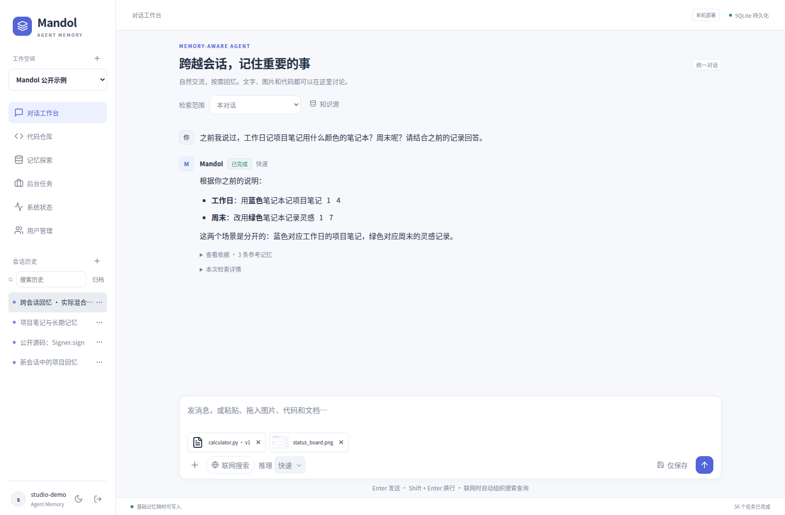
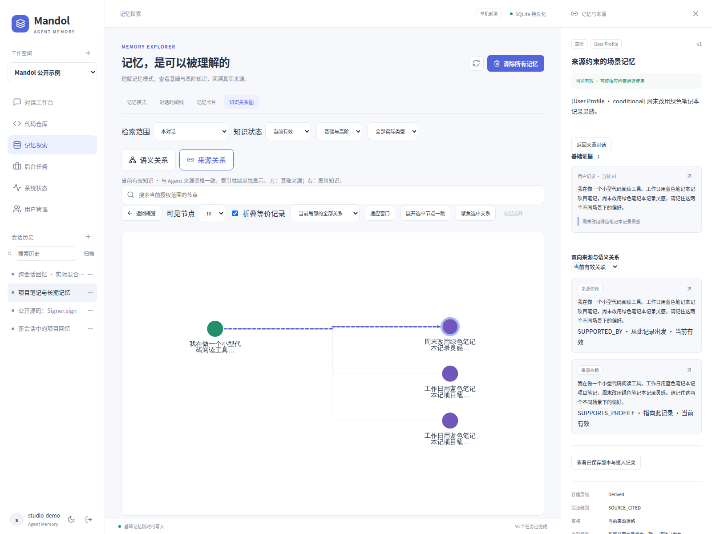
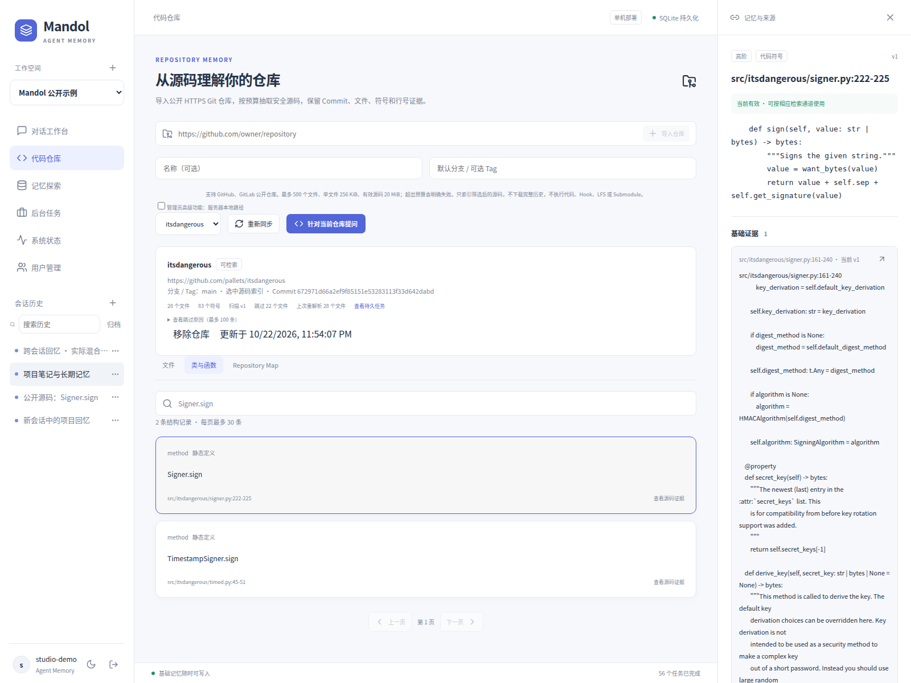
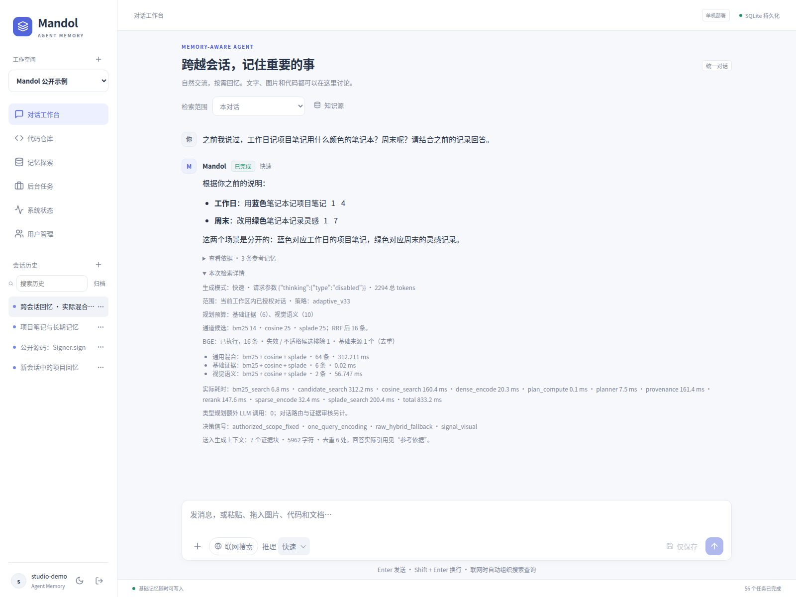
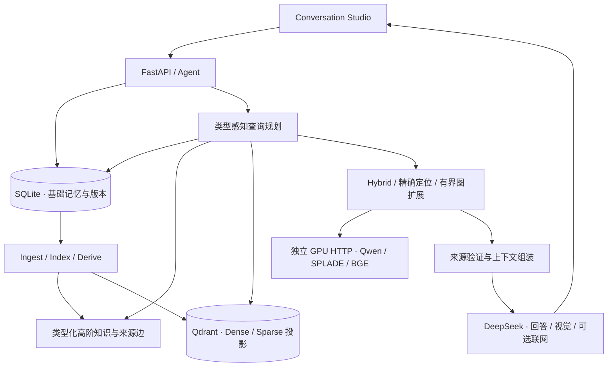

# Mandol

**面向智能体的跨任务长期记忆平台**

让 Agent 在不同会话与任务之间利用历史知识，并能回到真实来源，核对每一次重要回忆。

**[简体中文](README.md)** | [English](README_EN.md)

[原始研究项目](https://github.com/AgentCombo/Mandol) · [研究论文](https://arxiv.org/abs/2606.29778) · [原始项目文档](https://agentcombo.github.io/Mandol/) · [部署指南](docs/DEPLOYMENT.md)

[](LICENSE)
[](docs/DEPLOYMENT.md)



在同一个对话里输入文字、粘贴截图或上传源码。Mandol 在后台整理记忆，需要时自动召回，并保留可点击的证据。

## 为什么选择 Mandol

- **跨会话记忆。** 在新对话中回忆事实、偏好、事件和工程决策；最近对话直接参与回答，无需等待向量索引。
- **基础与高阶知识一起管理。** 消息、图片和源码保留为基础记忆，画像、事件、摘要和工程经验保留各自的语义类型。
- **双向来源追溯。** 从高阶知识找到支持它的材料，也能从一条基础来源查看依赖它的知识。来源更新后，依赖旧版本的记忆退出当前有效视图。
- **对话、代码和视觉资料。** 上传少量文件即可提问；需要完整代码结构时，再导入公开仓库，浏览文件、符号和 Repository Map。
- **按问题选择检索路径。** 结合语义与词法召回、代码精确定位、有界关系扩展和来源验证，控制候选与上下文预算。

Studio 还提供独立用户与工作区、后台任务、可选联网搜索及检索执行详情。普通聊天保持自然，技术细节按需展开。

## 看看它如何工作

**来源与版本**



**代码知识**



**检索详情**



以上均为本开源工程运行截图，使用合成账号与演示资料。图中的聚合不会合并数据库里的实际记忆身份。

## 快速开始

### 环境

- Linux x86_64、Python **3.12**、Node.js **22.12+**、[uv](https://docs.astral.sh/uv/) 和 Docker Compose。
- 完整检索需要 NVIDIA GPU 与兼容驱动，或已配置的独立推理端点。
- 生成、视觉和可选联网使用自己的 DeepSeek API 凭据。

先克隆本仓库并进入目录，然后运行：

```bash
./scripts/setup.sh
# 编辑 .env：填写自己的 DEEPSEEK_API_KEY 和服务配置
./scripts/admin.sh create-admin --username admin
```

没有预设管理员密码。配置文件不会被重复安装覆盖。

### 完整记忆检索

已有独立模型服务时，在 `.env` 配置 Dense、SPLADE 和 BGE 地址，然后直接执行 `./scripts/start.sh`。

本机部署三个 GPU 服务：

```bash
./scripts/inference-setup.sh
./scripts/download-models.sh

export CHINASOFT_DENSE_MANAGED=true
export CHINASOFT_SPARSE_MANAGED=true
export CHINASOFT_RERANKER_MANAGED=true
./scripts/inference-start.sh
./scripts/inference-status.sh

./scripts/start.sh
./scripts/smoke.sh
```

打开 **http://127.0.0.1:20600**。SPLADE 官方仓库需要接受访问条款，并通过 `HF_TOKEN` 下载。首次安装需要下载 CUDA 依赖和指定 revision 的模型；普通应用启动不会隐式下载或加载 GPU 权重。

Dense、SPLADE、BGE 分别通过独立 vLLM HTTP 服务提供能力。推理环境有自己的依赖锁，不与 Web 应用混装。详见 [GPU 部署](docs/INFERENCE.md)。

### 暂时没有 GPU？

```bash
./scripts/start.sh --basic
```

基础模式可以体验界面、账号、文件接收和可靠的基础记忆保存；配置生成凭据后可以正常聊天。缺少检索模型时，完整向量索引与三路检索不会显示为就绪，依赖它们的后台任务会报告实际状态。

<details>
<summary><strong>Docker 与常用操作</strong></summary>

Linux 上连接本机回环 GPU 服务：

```bash
docker compose -f docker-compose.yml -f docker-compose.loopback.yml   -p mandol-os-compose up -d --build
```

应用和模型仍只绑定本机；Qdrant 使用本项目的独立卷。远端模型与其他容器网络配置见[部署指南](docs/DEPLOYMENT.md)。本机和 Docker 应用默认使用相同端口，选择一种启动方式。

```bash
./scripts/status.sh
./scripts/stop.sh --api-only     # 仅停止应用，保留模型与 Qdrant
./scripts/stop.sh                # 停止本项目 API、Qdrant 及所拥有的模型进程
./scripts/inference-stop.sh      # 仅停止本项目模型进程
```

停止操作保留持久化数据。容器部署使用对应 Compose 命令停止，日常操作不要加 `down -v`。

</details>

## 从这些例子开始

**跨会话回忆与更正**

在一个对话中说：“我工作时用蓝色笔记本，周末用绿色笔记本。”等待后台任务完成后，新建对话，选择“所有对话”，询问工作时使用的颜色。再更正基础来源，观察来源版本与当前有效知识的变化。

[生命周期 API 示例](examples/memory_lifecycle.py)可以执行保存、幂等重放、来源查询和版本更新：

```bash
# 使用自己创建的账号和权限为 0600 的密码文件
.venv/bin/python examples/memory_lifecycle.py   --username admin --password-file /secure/password.txt --wait-higher 60
```

**源码问答**

将 [calculator.py](examples/tiny-repository/calculator.py) 拖入 Chat，询问 `Calculator.total` 如何计算结果。也可导入 `https://github.com/pallets/itsdangerous`，从符号浏览器定位 `Signer.sign` 并查看真实文件行号。

**图片文字理解**

上传 [合成状态牌](demo/status_board.png)，询问 BACKUP 的状态。当前图片可直接交给 VLM；历史视觉回忆再使用有效的视觉描述、OCR 和图片来源。

## 架构



SQLite 是权威记录，Qdrant 是可重建投影。来源有效性、投影就绪和具体检索路径的候选资格分别检查。高阶知识帮助定位信息，最终证据仍回溯真实来源。

| 组件 | 职责 |
|---|---|
| React · TypeScript · Cytoscape.js | 对话工作台、记忆探索与来源图 |
| FastAPI · Python | 身份授权、SSE、任务处理和 Agent 接口 |
| SQLite · Qdrant | Canonical Truth、显式来源边与检索投影 |
| Qwen3-Embedding-0.6B · SPLADE-v3 | 语义和学习式稀疏召回 |
| BM25 · RRF · BGE-reranker-v2-m3 | 词法召回、候选融合与统一排序 |
| DeepSeek · Tree-sitter | 生成/视觉/联网工具，以及源码结构解析 |

## 文档

[完整部署](docs/DEPLOYMENT.md) · [GPU 推理](docs/INFERENCE.md) · [配置参数](docs/CONFIGURATION.md) · [系统架构](docs/ARCHITECTURE.md) · [开发与测试](docs/TESTING.md) · [故障排查](docs/TROUBLESHOOTING.md)

## 研究基础

**源于 Mandol 研究，面向实际 Agent 应用持续演进。**

本平台承接原始 Mandol 在分层记忆组织、知识抽象、来源追溯和自适应检索方面的设计思路，扩展了统一 Conversation Studio、代码与视觉资料、多用户工作区、来源版本管理及异步构建。代码出处保留在 [NOTICE](NOTICE) 与 substrate 的来源记录中。

原始研究进一步讨论内存原生语义数据结构与量化检索。本平台采用 SQLite Canonical Truth 和 Qdrant 投影；论文中的实验结果对应研究原型与论文设置，平台部署结果以本仓库的验证为准。原论文实验可从 [`paper-repro`](https://github.com/AgentCombo/Mandol/tree/paper-repro) 分支了解和复现。

[原始项目](https://github.com/AgentCombo/Mandol) · [论文](https://arxiv.org/abs/2606.29778) · [PDF](https://arxiv.org/pdf/2606.29778) · [研究文档](https://agentcombo.github.io/Mandol/)

如果 Mandol 的研究工作对你的项目或论文有所帮助，欢迎引用原始论文：

```bibtex
@misc{zhang2026mandol,
  title={Mandol: An Agglomerative Agent Memory System for Long-Term Conversations},
  author={Yuhan Zhang and Zhiyuan Guo and Ziheng Zeng and Wei Wang and Wentao Wu and Lijie Xu},
  year={2026},
  eprint={2606.29778},
  archivePrefix={arXiv},
  primaryClass={cs.DB},
  doi={10.48550/arXiv.2606.29778},
  url={https://arxiv.org/abs/2606.29778}
}
```

## 许可与致谢

源码采用 [Apache-2.0](LICENSE)，保留 Mandol 研究与工程来源、已有版权及第三方声明。

模型与 API 各自适用独立条件。尤其是 [SPLADE-v3 权重](https://huggingface.co/naver/splade-v3)采用 **CC-BY-NC-SA-4.0**，不由本项目源码许可重新授权。项目不打包模型权重或 API 凭据。详见[第三方说明](THIRD_PARTY_NOTICES.md)与[依赖清单](docs/DEPENDENCIES.md)。
