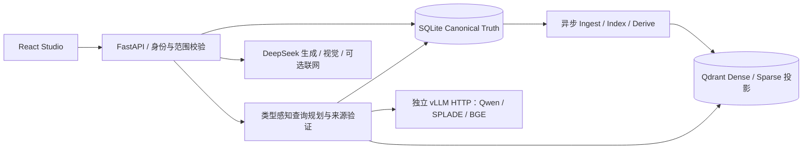

# Mandol Agent Memory Platform

**面向智能体的跨任务长期记忆平台**

Mandol 将对话、图片、文档和源码保存为可追溯的基础记忆，异步构建用户画像、事件、实体关系、工程经验和视觉知识。回答问题时，系统按查询需要选择记忆类型、检索路径和有效来源，让长期记忆参与自然对话。

A conversation-first agent memory platform with typed retrieval, asynchronous memory construction, and versioned provenance.

## 能做什么

- 统一对话工作台：流式回答、多轮上下文、历史会话、图片粘贴及代码文件上传。
- 基础与高阶记忆：后台构建、来源版本验证、失效传播和双向来源追溯。
- 记忆探索：Semantic Schema、时间线、卡片、当前有效图与历史审计图。
- 类型感知检索：对话 Hybrid、代码符号和路径、视觉/OCR、画像生命周期与有界关系扩展。
- 代码知识：公开 HTTPS 仓库的有界导入、Tree-sitter 解析、符号与 Repository Map。
- 多用户：Argon2id 密码、可撤销 Cookie Session、工作区隔离、管理中心和资源配额。
- 可选联网：DeepSeek Search/Fetch、自动查询规划、独立网页引用和检索执行详情。

这里包含产品运行所需的源码及迁移逻辑，不包含用户数据、模型权重、API 凭据或私有研发记录。

## 系统结构



SQLite 是真实记录；Qdrant 是可重建的检索投影。模型权重不在 Web 应用进程中加载。Worker 随单个 API 进程启动；当前部署不提供独立分布式 Worker 服务。

## 环境要求

Linux、Python 3.12、Node.js 22 或更新版本、uv、Docker 和 Compose 插件。基础安装不需要 GPU；完整检索需要三个符合协议的独立 GPU HTTP 服务。生成、视觉与联网需要用户自行提供的 DeepSeek 凭据。

## 快速开始

```bash
git clone <你的仓库地址> mandol
cd mandol
./scripts/setup.sh
# 编辑 .env，配置自己的 HTTP 推理端点和 DeepSeek 凭据
./scripts/admin.sh create-admin --username admin
./scripts/start.sh
./scripts/smoke.sh
```

打开 **http://127.0.0.1:20600**，使用自己创建的账号登录。没有默认管理员密码。公开注册默认关闭，可按[配置说明](docs/CONFIGURATION.md)开启。

如果暂时没有检索模型，可以明确选择基础检查模式：

```bash
./scripts/start.sh --basic
```

此模式能验证登录、SQLite、附件、后台任务接收和前端。配置真实生成凭据后可以自然聊天；缺少 GPU 端点时，向量索引和完整三路检索不会被标记为就绪，相关任务可能等待或失败。这不是完整检索的替代实现。

本轮独立验收发现：公开 PyPI 的 vLLM 0.29.0 依赖在本机无法完成解析，详见[推理部署](docs/INFERENCE.md)。因此本机一键 GPU 安装尚有明确限制；不要把基础模式启动成功当作 GPU 检索成功。

## 容器部署

```bash
cp -n .env.example .env
# 编辑 .env，填写容器可访问的独立模型地址与 API 凭据
docker compose -p mandol-os-compose up -d --build
# 使用交互式终端设置新管理员密码
docker compose -p mandol-os-compose exec app python -m mandol_competition.chinasoft.admin create-admin --username admin
```

容器和本机方式二选一，默认均使用 20600/20633。容器内通过 `host.docker.internal` 访问的服务必须监听可达地址；只绑定宿主机 127.0.0.1 的 GPU 服务不能通过 Linux Docker bridge 访问。本机 GPU 场景优先使用本机应用启动方式，或配置独立远端端点。

## 示例

登录后创建对话，可以先说“这个示例项目使用蓝色笔记本”，再追问当前对话的内容。启用完整模型后，可以等待后台构建，在另一个对话选择“所有对话”进行回忆，并打开来源查看真实依据。

`demo/status_board.png` 是本项目新制作的合成状态牌，可测试粘贴图片与视觉问答。`examples/tiny-repository/` 是全新编写的源码示例，可作为代码附件上传，或按其说明初始化 Git 仓库后供显式授权的本地管理员扫描。

API 读写检查：

```bash
# 密码文件由操作者自行创建，权限必须为 0600；不要加入 Git
./scripts/smoke.sh --write --username admin --password-file /安全位置/password.txt
```

## 常用命令

| 命令 | 用途 |
|---|---|
| `./scripts/setup.sh` | 安装锁定依赖、构建前端、初始化 SQLite；保留已有 .env |
| `./scripts/start.sh` | 启动独立 Qdrant 和 API；不会自动启动 GPU 模型 |
| `./scripts/status.sh` | 查看当前项目健康状态 |
| `./scripts/smoke.sh` | 只读 HTTP 健康检查 |
| `./scripts/stop.sh` | 停止本项目拥有的进程和容器，保留持久化数据 |
| `./scripts/inference-setup.sh` | 显式安装隔离 vLLM 环境；当前依赖冲突会报错停止 |
| `./scripts/inference-start.sh` | 显式启动标记为 MANAGED 的模型服务 |
| `npm --prefix studio run dev -- --port 20601` | 前端开发服务器；代理本机 20600 API |

## 文档

[部署](docs/DEPLOYMENT.md) · [配置](docs/CONFIGURATION.md) · [架构](docs/ARCHITECTURE.md) · [推理协议](docs/INFERENCE.md) · [故障排查](docs/TROUBLESHOOTING.md) · [测试](docs/TESTING.md)

## 来源与许可

本项目承接 Mandol 研究代码及 ChinaSoft 工程，源码经权利人授权采用 **Apache-2.0**，详见 [LICENSE](LICENSE) 和 [NOTICE](NOTICE)。复用的 substrate 包保留原有许可和出处。

外部模型和 API 不随源码重新授权。[NAVER SPLADE-v3](https://huggingface.co/naver/splade-v3) 的模型卡标注 **CC-BY-NC-SA-4.0**，应按其条件评估使用场景，不能将 Apache-2.0 源码许可证理解为对该权重的商业授权。其他组件见[第三方声明](THIRD_PARTY_NOTICES.md)。
