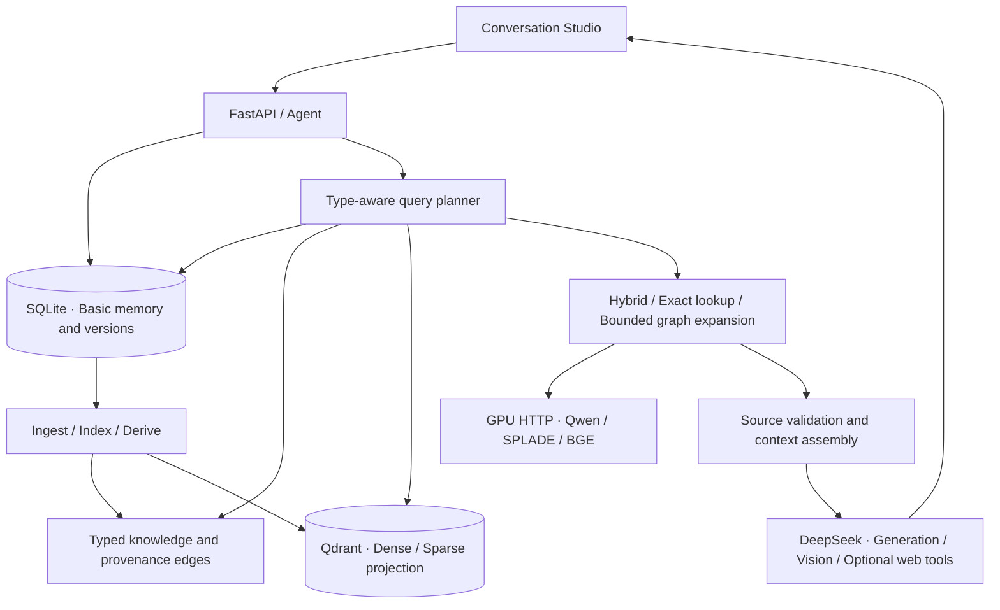

# Mandol

**Long-term memory for AI agents**

Remember across conversations and tasks. Trace important knowledge back to its sources.

[简体中文](README.md) | **[English](README_EN.md)**

[Original Research](https://github.com/AgentCombo/Mandol) · [Research Paper](https://arxiv.org/abs/2606.29778) · [Research Docs](https://agentcombo.github.io/Mandol/) · [Deployment Guide](docs/DEPLOYMENT.md)

[](LICENSE)
[](docs/DEPLOYMENT.md)


Chat, paste a screenshot, or drop in source files. Mandol organizes memory in the background and brings relevant knowledge into later answers, with sources you can inspect.

## Why Mandol?

- **Memory across conversations.** Recall facts, preferences, events, and engineering decisions in a new conversation. Recent messages remain available immediately, before indexing finishes.
- **Basic and higher-level memory.** Keep messages, images, and source files alongside typed profiles, episodes, summaries, and engineering experience.
- **Provenance in both directions.** Follow knowledge back to its supporting material, or inspect what was built from a source. Updating a source removes knowledge that depends on its old version from the current valid view.
- **Conversation, code, and visual knowledge.** Ask about a few uploaded files, or import a public repository when you need files, symbols, and a Repository Map.
- **Retrieval suited to the question.** Combine semantic and lexical retrieval, exact code lookup, bounded graph expansion, and source validation within explicit candidate and context budgets.

Studio also includes private accounts and workspaces, background jobs, optional web search, and expandable retrieval details. Everyday conversations stay focused on the answer.

## Explore the platform

**Sources and versions**


**Repository knowledge**


**Retrieval details**


These screenshots come from this open-source application using synthetic accounts and demo data. Visual grouping preserves the identities of the underlying records.

## Quick start

### Requirements

- Linux x86_64, Python **3.12**, Node.js **22.12+**, [uv](https://docs.astral.sh/uv/), and Docker Compose.
- Full retrieval needs an NVIDIA GPU with a compatible driver, or explicitly configured remote inference endpoints.
- Bring your own DeepSeek credentials for generation, vision, and optional web tools.

Clone this repository, open its directory, then run:

```bash
./scripts/setup.sh
# Edit .env: set your DEEPSEEK_API_KEY and service configuration
./scripts/admin.sh create-admin --username admin
```

Choose your own administrator password. Re-running setup preserves your configuration.

### Full memory retrieval

If you already have compatible inference services, configure the Dense, SPLADE, and BGE endpoints in `.env`, then run `./scripts/start.sh`.

To deploy the three GPU services locally:

```bash
./scripts/inference-setup.sh
./scripts/download-models.sh

export CHINASOFT_DENSE_MANAGED=true
export CHINASOFT_SPARSE_MANAGED=true
export CHINASOFT_RERANKER_MANAGED=true
./scripts/inference-start.sh
./scripts/inference-status.sh

./scripts/start.sh
./scripts/smoke.sh
```

Open **http://127.0.0.1:20600**. SPLADE requires accepting its model access terms and supplying `HF_TOKEN`. The first installation downloads CUDA dependencies and pinned model revisions. Starting the application does not implicitly download or load GPU weights.

Dense, SPLADE, and BGE run as separate HTTP services on **vLLM 0.32.0 and Python 3.12**, using one project-local inference environment isolated from the Web application. See the [GPU deployment guide](docs/INFERENCE.md).

### Start without a GPU

```bash
./scripts/start.sh --basic
```

Basic mode lets you explore Studio, accounts, file reception, and durable basic memory. With generation credentials, you can also chat. Missing retrieval models remain visibly unavailable: full vector indexing and three-channel retrieval are not reported as ready, and dependent jobs retain their actual status.

<details>
<summary><strong>Docker and common commands</strong></summary>

On Linux, connect the application container to local loopback GPU services:

```bash
docker compose -f docker-compose.yml -f docker-compose.loopback.yml   -p mandol-os-compose up -d --build
```

The application and model endpoints stay bound to loopback. Qdrant uses its own project volume. For remote models and bridge networking, see the [deployment guide](docs/DEPLOYMENT.md). Native and Docker application modes use the same default ports; choose one.

```bash
./scripts/status.sh
./scripts/stop.sh --api-only     # Keep model services and Qdrant running
./scripts/stop.sh                # Stop this project's native app, Qdrant, and owned models
./scripts/inference-stop.sh      # Stop only this project's model services
```

Stopping preserves persistent data. Stop a container deployment with its matching Compose command; do not add `down -v` for ordinary restarts.

</details>

## Try it

**Recall a preference, then update its source.**

In one conversation, say: “I use a blue notebook for work and a green one on weekends.” Wait for the background jobs, open a new conversation, select all conversations, and ask about the work notebook. Update the basic source and inspect how its version and current knowledge change.

The [lifecycle API example](examples/memory_lifecycle.py) saves a source, replays an idempotent request, queries provenance, and updates its version:

```bash
# Use your own account and a password file with mode 0600
.venv/bin/python examples/memory_lifecycle.py   --username admin --password-file /secure/password.txt --wait-higher 60
```

**Ask about source code.**

Drop [calculator.py](examples/tiny-repository/calculator.py) into Chat and ask how `Calculator.total` works. Or import `https://github.com/pallets/itsdangerous`, find `Signer.sign` in the symbol browser, and inspect its actual source lines.

**Read an image.**

Upload the [synthetic status board](demo/status_board.png) and ask for the BACKUP status. Current images can go directly to the VLM; historical visual recall uses valid descriptions, OCR, and image provenance.

## Architecture



SQLite owns the canonical records; Qdrant is a rebuildable projection. Source validity, projection readiness, and lane-specific eligibility are checked separately. Higher-level knowledge locates information while evidence leads back to the actual sources.

| Component | Role |
|---|---|
| React · TypeScript · Cytoscape.js | Conversation Studio, memory exploration, and provenance views |
| FastAPI · Python | Authorization, SSE, background processing, and Agent APIs |
| SQLite · Qdrant | Canonical truth, explicit edges, and retrieval projections |
| Qwen3-Embedding-0.6B · SPLADE-v3 | Dense and learned sparse retrieval |
| BM25 · RRF · BGE-reranker-v2-m3 | Lexical retrieval, candidate fusion, and reranking |
| DeepSeek · Tree-sitter | Generation, vision, web tools, and source-code parsing |

## Documentation

[Deployment](docs/DEPLOYMENT.md) · [GPU inference](docs/INFERENCE.md) · [Configuration](docs/CONFIGURATION.md) · [Architecture](docs/ARCHITECTURE.md) · [Development and tests](docs/TESTING.md) · [Troubleshooting](docs/TROUBLESHOOTING.md)

## Research and origins

**From memory research to practical AI agent applications.**

Mandol Agent Memory Platform builds on the original Mandol work on hierarchical memory, knowledge abstraction, provenance, and adaptive retrieval. It extends those ideas with Conversation Studio, code and visual knowledge, private workspaces, source versioning, and asynchronous construction. Attribution remains in [NOTICE](NOTICE) and the bundled substrate records.

The original research also explores in-memory semantic data structures and quantitative retrieval. This platform uses SQLite canonical truth and Qdrant projections. Paper results apply to the research prototype and its experimental settings; this deployment is assessed through its own tests. Explore the [`paper-repro` branch](https://github.com/AgentCombo/Mandol/tree/paper-repro) for the original experiments.

[Original project](https://github.com/AgentCombo/Mandol) · [Paper](https://arxiv.org/abs/2606.29778) · [PDF](https://arxiv.org/pdf/2606.29778) · [Research documentation](https://agentcombo.github.io/Mandol/)

If you find the Mandol research useful, please consider citing the original paper:

```bibtex
@misc{zhang2026mandol,
  title={Mandol: An Agglomerative Agent Memory System for Long-Term Conversations},
  author={Yuhan Zhang and Zhiyuan Guo and Ziheng Zeng and Wei Wang and Wentao Wu and Lijie Xu},
  year={2026},
  eprint={2606.29778},
  archivePrefix={arXiv},
  primaryClass={cs.DB},
  doi={10.48550/arXiv.2606.29778},
  url={https://arxiv.org/abs/2606.29778}
}
```

## License and acknowledgements

Source code is licensed under [Apache-2.0](LICENSE). Existing Mandol research attribution, copyright notices, and third-party notices are retained.

Models and APIs have separate terms. In particular, [SPLADE-v3 weights](https://huggingface.co/naver/splade-v3) use **CC-BY-NC-SA-4.0** and are not relicensed by this repository. Model weights and API credentials are not bundled. See [third-party notices](THIRD_PARTY_NOTICES.md) and the [dependency inventory](docs/DEPENDENCIES.md).
